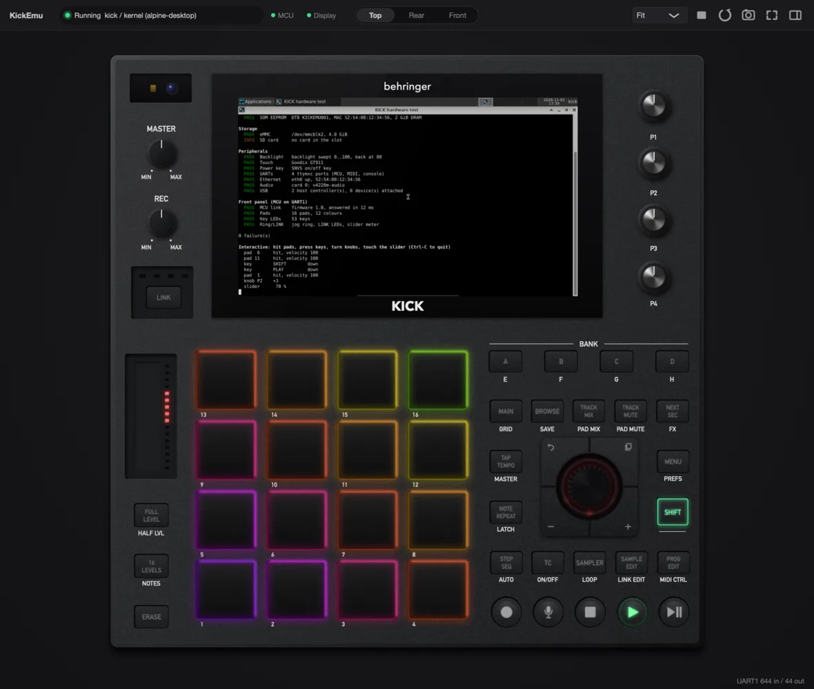
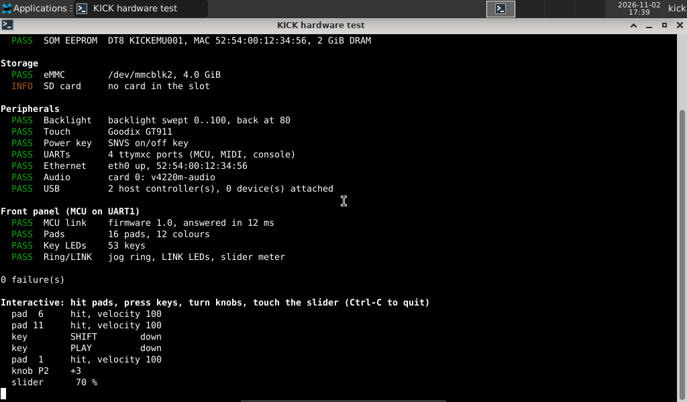

# kick-hwtest

Hardware check and front panel demo for Linux on the KICK, in KickEmu or on the device.
One static arm64 binary with no dependencies.

<p align="center">
  
</p>

It runs in three parts:

1. **Report.** What the kernel sees, one PASS/FAIL/INFO line each: SoC and revision, CPUs,
   memory, TMU temperature, RTC, the Variscite SOM EEPROM (read over `/dev/i2c-0`, the
   vendor kernel has no at24 driver), eMMC, SD card, backlight (swept down and back up),
   Goodix touch, SNVS power key, UARTs, Ethernet, ALSA cards, USB.
2. **Light test** over the control-surface MCU on UART1 (`/dev/ttymxc0`, 230400 8N1), in the
   packets the KICK application uses (`Kick/modules/contracts/dcl`): every pad in 12 colours,
   then one by one; the 53 key LEDs; the jog ring; the LINK LEDs; the slider meter.
3. **Interactive.** The pads run a rainbow and flash white when hit, keys light while held,
   pad hits, keys, knobs, the jog wheel and the slider are printed. Ctrl-C turns everything off.

It never opens an audio device: sound cards are listed, nothing is played.

<p align="center">
  
</p>

## Usage

```
kick-hwtest [--once] [--no-backlight] [--mcu /dev/ttyX]
```

| Option | Effect |
|---|---|
| `--once` | report and light test, then exit; the exit code is the number of failures |
| `--no-backlight` | report the backlight level instead of sweeping it |
| `--mcu <tty>` | MCU port (default `/dev/ttymxc0`) |

As a non-root user it needs the `dialout` group (MCU), access to `/dev/i2c-0` (EEPROM) and
write access to the backlight's `brightness`; checks it cannot run are reported as SKIP.

## In the Alpine desktop image

`Emulator/desktop/build.sh` compiles it into the image, sets up those permissions for the
desktop user and starts it in a terminal when Xfce comes up:

```sh
Emulator/desktop/build.sh && $KICKEMU --profile alpine-desktop
```

In CI, run it headless through the automation interface and check the exit code:

```python
k.call("console_run", command="kick-hwtest --once; echo exit=$?", timeout_ms=60000)
```

## Building it on its own

On an arm64 Alpine host or container (`docker run --platform linux/arm64 alpine:3.22`):

```sh
apk add build-base linux-headers
gcc -O2 -Wall -Wextra -static -s -I Emulator/demo/baremetal/src -o kick-hwtest \
    Emulator/desktop/hwtest/kick-hwtest.c Emulator/demo/baremetal/src/pktmgr.c
```

The packet code (`pktmgr.c`) is shared with the bare-metal demo. Prebuilt binaries are attached
to the `hwtest-v*` releases.
