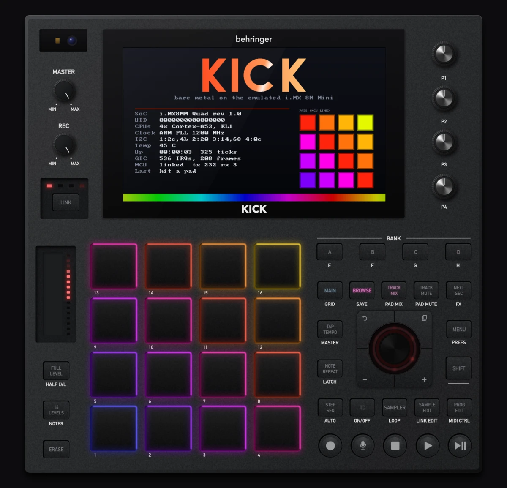
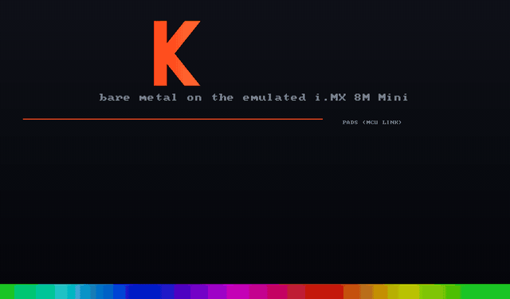
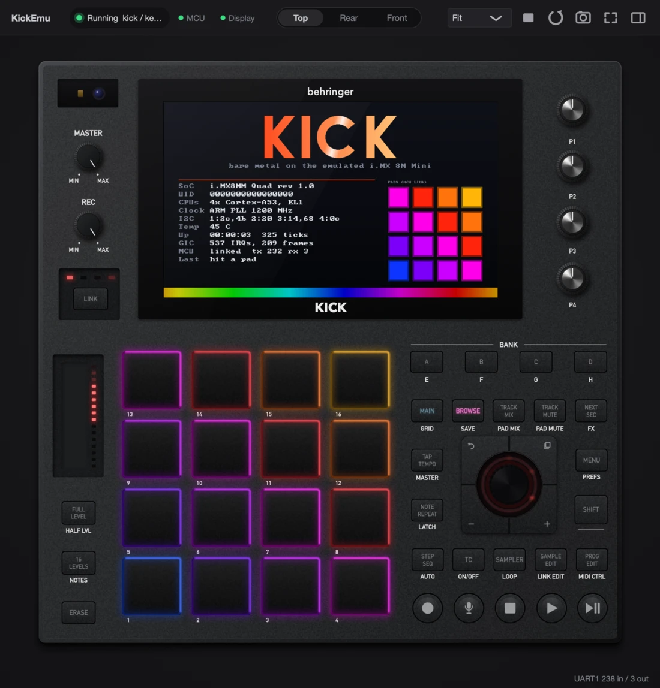

<h1 align="center">KickEmu</h1>

<p align="center">
  <b>A register-level emulator of the Behringer KICK (BE 0700-AAM) for macOS on Apple Silicon.</b><br>
  Runs the unmodified boot chain, vendor kernel and the KICK application on an emulated i.MX 8M Mini,<br>
  with a 1:1 front panel, CoreMIDI, CoreAudio, touch and CV.
</p>

<p align="center">
  
  
  
  
  
  
  
  
  
  <a href="LICENSE"></a>
</p>

<p align="center">
  
</p>

## What it is

KickEmu runs software built for the KICK on a Mac, without changing it. It is a QEMU
machine (`-M kick`) with register-level models of the i.MX 8M Mini peripherals and the
KICK board, plus a native app that draws the device, plays the control-surface MCU and
connects the emulated MIDI, audio and CV ports to the host.

- **Fast.** Apple Hypervisor (HVF) runs the four Cortex-A53 cores at native speed: the vendor
  kernel boots to a shell in about 1.5 s. TCG runs the full chain from the BootROM.
- **Register-level.** Drivers see the real hardware: clocks and PLLs, power domains, I2C,
  UARTs with SDMA, SAI audio, eLCDIF, MIPI-DSI, the SN65DSI84 bridge, uSDHC with CQHCI,
  Ethernet with its PHY, the PMIC, touch, RTC and the CV DAC. Details in
  [Emulator/docs/soc.md](Emulator/docs/soc.md).
- **The real front panel.** 16 RGB pads with velocity, all buttons with their legends lit
  by the firmware, four encoders, the jog wheel and its LED ring, the touch slider, MASTER
  and REC, plus rear and front views with every jack. Drawn to scale from the device.
- **Full I/O.** CoreMIDI ports "KICK MIDI In/Out", audio through CoreAudio, touch on the
  screen, CV/gate values, the serial console and SSH into the guest.

<table>
  <tr>
    <td width="50%"></td>
    <td width="50%"></td>
  </tr>
  <tr>
    <td align="center"><sub>The 1024x600 panel, scanned out by the emulated eLCDIF</sub></td>
    <td align="center"><sub>KickEmu window: machine status, views, zoom, snapshot, side panel</sub></td>
  </tr>
</table>

## Status

| Area | State |
|---|---|
| Vendor kernel 5.4.127 + KICK device tree | Boots under HVF and TCG; board self-test 26 of 28 pass |
| U-Boot 2020.04 proper (`boot-mode=uboot`) | Boots under HVF and TCG |
| BootROM, SPL, LPDDR4 training, ATF (`boot-mode=rom`) | Runs up to the hand-over to U-Boot (TCG) |
| Display: eLCDIF, MIPI-DSIM, SN65DSI84, 1024x600 panel | Working, live in KickEmu |
| GPU: Vivante GC600 3D / GC520 2D | Register shell, MMUv2, 2D blits; 3D command stream accepted, no rasterizer yet |
| Audio: SAI2 + SDMA2, 48 kHz S32 | Playback and capture exact, through CoreAudio |
| Control surface MCU (UART1, PktMgr protocol) | Emulated in KickEmu: pads, buttons, encoders, jog, slider, all LEDs |
| MIDI (UART3) | CoreMIDI bridge |
| UARTs (own model: FIFOs, line timing, ageing/idle) over SDMA | 20 KB round trips exact on the MCU and MIDI ports, no NXP firmware needed |
| KICK application (KT_Kick) on Debian 12 (`--profile kick-app`) | Runs with screen, touch, MCU link, audio and network; app screen after about 17 s under HVF |

Open items are listed in [Emulator/docs/soc.md](Emulator/docs/soc.md#known-gaps).

## Quick start

Requirements: macOS on Apple Silicon, Xcode command line tools, CMake, Ninja, Meson and
`brew install glib pixman dtc libslirp`. The kernel and boot chain build in a container
(OrbStack or Docker).

```sh
git clone --recursive https://github.com/DistrubedElectrons/KickEMU.git && cd KickEMU

Emulator/qemu/build.sh                                   # QEMU with the kick machine
cmake -S Emulator/demo/baremetal -B Emulator/out/demo -G Ninja && cmake --build Emulator/out/demo
cmake -S Emulator/host -B Emulator/out/host -G Ninja -DCMAKE_BUILD_TYPE=Release
cmake --build Emulator/out/host

KICKEMU=Emulator/out/host/KickEmu_artefacts/Release/KickEmu.app/Contents/MacOS/KickEmu
$KICKEMU --profile demo --presentation                   # bare-metal demo, no Linux needed
```

Linux and the KICK application:

```sh
Emulator/boot/build.sh                                   # vendor kernel, DTBs, U-Boot, ATF (container)
Emulator/testimage/build.sh && $KICKEMU --profile selftest   # Alpine test image + board self-test
Emulator/rootfs/build.sh && $KICKEMU --profile kick-app      # Debian 12 with KT_Kick
```

The full build guide is in [Emulator/README.md](Emulator/README.md), the root file system
for the app in [Emulator/rootfs/README.md](Emulator/rootfs/README.md).

| Shortcut | Action |
|---|---|
| Cmd+P | presentation mode (device only); leave it with Cmd+P, the button at the top edge or a right-click |
| Cmd+0 / Cmd+1..3 | fit window to the device / top, rear, front view |
| Cmd+Shift+S | 2x PNG snapshot |
| Cmd+R / Cmd+. | restart / stop the machine |
| Keyboard | pads, buttons and encoders (map in the side panel) |

## How it fits together

```
 KickEmu (JUCE, native)                         QEMU -M kick (HVF or TCG)
 ┌───────────────────────────┐   vnc.sock     ┌──────────────────────────────────────┐
 │ front panel, screen, touch│◀──────────────▶│ eLCDIF ▶ DSIM ▶ SN65DSI84 ▶ panel     │
 │ MCU emulator (PktMgr)     │◀── mcu.sock ──▶│ UART1  ── SDMA1                       │
 │ CoreMIDI ports            │◀── midi.sock ─▶│ UART3  ── SDMA1                       │
 │ CV/gate readout           │◀── cv.sock ───▶│ I2C4 AD5671R                          │
 │ console                   │◀── console ───▶│ UART4                                 │
 │ QMP: touch, power, status │◀── qmp.sock ──▶│ GT911 on I2C3, SNVS power key         │
 └───────────────────────────┘   CoreAudio ◀──│ SAI2 ── SDMA2                         │
                                              │ 4x Cortex-A53, GICv3, uSDHC3 eMMC ... │
                                              └──────────────────────────────────────┘
```

| Path | Contents |
|---|---|
| [Emulator/qemu](Emulator/qemu) | SoC, board and device models (`hw/kick`), qtests, QEMU patches |
| [Emulator/host](Emulator/host) | KickEmu: panel, launcher, MCU, MIDI, CV and console bridges |
| [Emulator/boot](Emulator/boot) | Container build of kernel, DTBs, GPU module, ATF, U-Boot, imx-boot |
| [Emulator/testimage](Emulator/testimage) | Alpine test image with `kick-selftest` |
| [Emulator/rootfs](Emulator/rootfs) | Debian 12 root file system with the KICK application |
| [Emulator/demo/baremetal](Emulator/demo/baremetal) | Bare-metal demo and reference for own firmware |
| [Emulator/docs](Emulator/docs) | Architecture, SoC, display/GPU and device model notes |
| [README.KICK.md](README.KICK.md) | The original KICK source tree (application, audio engine, Linux) |

## Contributing

Issues and pull requests are welcome. Before opening a pull request, run the host tests
(`ctest --test-dir Emulator/out/host --output-on-failure`) and the `kick-*` qtests from
[Emulator/qemu/tests](Emulator/qemu/tests). Contributions to the QEMU models stay under
GPL-2.0-or-later so they can be built into QEMU.

## License

Copyright (c) 2026 Distrubed Electrons.

KickEmu is free software under the [GNU Affero General Public License v3.0 or later](LICENSE).
You may use, study, modify and redistribute it. If you distribute a modified version, or run
one as a network service, you must publish its complete source under the same license, keep
the copyright notices, and credit **Distrubed Electrons** as the original author of KickEmu
(an additional term under AGPL-3.0 section 7(b), see [NOTICE](NOTICE)).

- The QEMU models in `Emulator/qemu/hw/kick` are additionally available under
  GPL-2.0-or-later, so they can be built into QEMU.
- The KICK source (`Kick/`, `AudIO/`, `ComProtocol/`) was released by MUSIC Tribe under
  AGPL-3.0-or-later; `Linux/` is Buildroot, GPL-2.0. See [README.KICK.md](README.KICK.md).
- JUCE is used under its AGPLv3 option; QEMU is GPL-2.0.
- NXP firmware (DDR training, SDMA RAM scripts) is not included.

KickEmu is an independent project and is not affiliated with or endorsed by MUSIC Tribe.
Behringer and KICK are trademarks of MUSIC Tribe.
